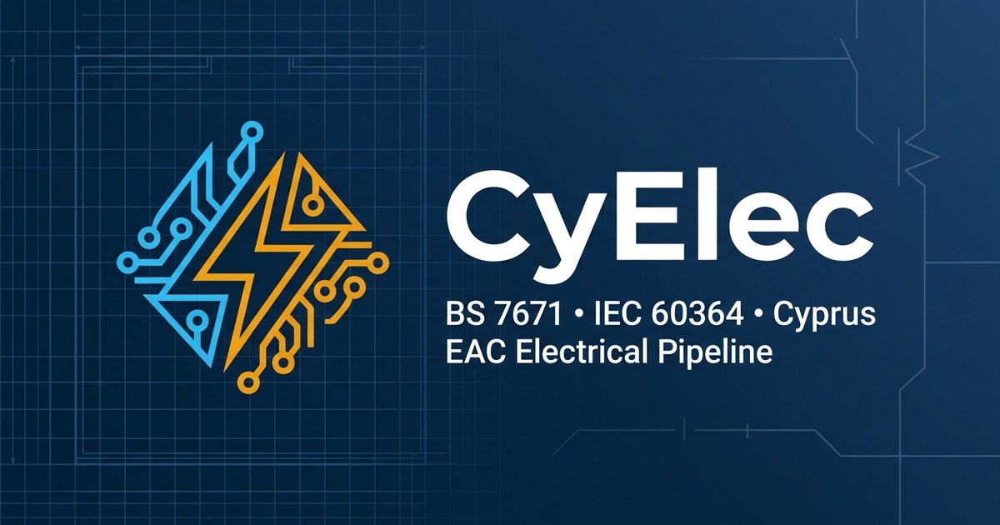

# cyelec-pipeline



Deterministic-first, zero-commercial-CAD-license Python 3.12 electrical engineering pipeline & EU **Multi-Tenant B2B SaaS** platform targeting **BS 7671**, **IEC 60364**, and **Electricity Authority of Cyprus (EAC)** plan-approval deliverables.

## Architecture Principles

- **Zero commercial CAD licenses & zero AGPLv3 SaaS traps:** Uses only MIT/BSD/LGPL Python packages (`ezdxf`, `shapely`, `networkx`, `pydantic`, `scipy`, `openpyxl`, `pyyaml`, `typer`, optional `ifcopenshell` / `weasyprint`). Never uses `PyMuPDF` (`fitz`). `QElectroTech` (GPLv2+) is isolated strictly as an external subprocess.
- **100% deterministic engineering core:** All spatial geometry, BS 7671 Section 701 wet zones, NetworkX conduit routing, cable sizing, derating ($C_a, C_g, C_i$), voltage drop, $Z_s$ / TT RCD touch-voltage verification, BS 7671 Section 722 EV protection, adiabatic CPC sizing, multi-floor sub-main cumulative $\Delta V$, Cyprus BOQ (EUR + 19% VAT), EAC supply tiering, and exact MILP 3-phase balancing are backed by versioned YAML standards tables in `standards/`.
- **Multi-Tenant EU B2B SaaS & ETEK Governance:** Strict per-tenant workspace isolation, PBKDF2-SHA256 API keys, Pass-2 `DesignOverrides` carry-forward across architectural revisions (`Rev 1` vs `Rev 2` deterministic diffing), tenant firm branding & bilingual EN/EL deliverables, usage metering, SHA-256 provenance, and an explicit `ReviewFlag` (`info` / `warning` / `blocker`) register gating statutory **ETEK Electrical Engineer** review and sign-off.

## Product Capabilities

1. **Messy Real-World DXF Resilience:** Recursive AutoCAD `INSERT` block explosion (Layer `"0"` inheritance & block-name hints), wall-to-room `shapely.ops.polygonize` fallback when `A-ROOM` polylines are missing, Cyprus Greeklish/abbreviated room aliases (`SALONI`, `KOUZ.`, `YPN. 1`, `MPANIO`, `WC/NTOYS`), pre-ingest DXF layer inspection (`POST /v1/dxf/layers`, `cyelec inspect-dxf --layers`), and explicit `DxfLayerMapping`.
2. **Multi-Floor Buildings, Multi-DXF Combiner & BS 7671:2018+A2 Checks (`MDB -> DB-GF / DB-1F`):** Combine separate floor DXF files (`cyelec solve-multifloor --floor GF=gf.dxf --floor 1F=1f.dxf` / `POST /v1/solve/dxf/multifloor`) into hierarchical `MDB -> DB-GF/DB-1F` sub-boards, BS 7671 sub-main feeder sizing at Cyprus 40°C ambient, TT time-delayed 100 mA Type S selective RCDs (Reg 536.4.1.4), cumulative $\Delta V$ enforcement ($\le 3\%$ lighting / $5\%$ power), hierarchical SLD SVG & DXF parity (with firm/ETEK titleblocks), and BS 7671:2018+A2 checks (PV bidirectional RCBO/busbar backfeed Reg 530.3.201 & 551.7.2, prospective fault current $I_{pf}$ `6 kA`/`10 kA` breaking capacity Reg 434.5.1, AFDD advisory Reg 421.1.7).
3. **Cyprus BOQ (Custom Tenant Rate Cards + Unpriced Tender BOQ), Branding, Bilingual EN/EL & Optional Native PDF:** Deterministic EUR Bill of Quantities exported as a 3rd live-formula Excel sheet (`Bill of Quantities`) + `boq.csv`, per-tenant saved custom EUR rate cards (`PUT /v1/tenants/me` with `boq_rate_overrides` & reduced 5% VAT support), unpriced **Tender BOQ** mode (`--tender-boq` / `tender_boq_blank_rates=true` leaving contractor Unit Rate cells blank with live auto-calc formulas), English / Greek / Bilingual (`EN / EL`) deliverables, firm & ETEK engineer branding, and optional BSD-licensed WeasyPrint native PDF export (`--pdf`).
4. **Interactive Click-to-Edit Visual Floorplan Workbench:** Zero-CDN, GDPR-safe ETEK review dashboard (`GET /`) featuring session-only `X-API-Key` auth (`sessionStorage`), click-to-reclassify rooms (`room_type_overrides`), click-to-relocate `DB1` (`db_location_override_mm`) with live NetworkX conduit re-routing, DXF Layer Mapping Wizard, live BOQ tab, and interactive Pass-2 circuit phase/grouping overrides.
5. **Production Multi-Tenant EU SaaS Workspace, `O(1)` Prefix Auth & GDPR Lifecycle:** Backend-agnostic `WorkspaceStoreProtocol` (SQLite default via `CYELEC_DB_PATH`, PostgreSQL drop-in ready), `O(1)` prefix-indexed PBKDF2-SHA256 API keys + `CYELEC_ADMIN_KEY` provisioning (`POST /v1/admin/tenants/{tenant_id}/api-key`), revision diffing & Pass-2 override carry-forward (`/v1/projects/{id}/diff/{rev_a}/{rev_b}`), full-route usage metering (`/v1/tenant/usage`), and EU GDPR Articles 17 & 20 endpoints (`DELETE /v1/projects/{project_id}`, `GET /v1/tenants/me/export`, `DELETE /v1/tenants/me`).

## Standards Tables (`standards/`)

| File | Scope |
| --- | --- |
| `standards/bs7671_cables.yaml` | Appendix 4 Method B (Cyprus masonry conduit default) & Method C ratings (`1.5–240 mm²`, 70°C PVC & 90°C XLPE/SWA), `mV/A/m`, 20°C resistance, $C_a$ (Table 4B1), $C_g$ (Table 4C1), $C_i$ (Table 52.2), temp multipliers (`1.20` / `1.28`) & adiabatic $k$ (`115` / `143`) |
| `standards/bs7671_devices.yaml` | BS 7671 Table 41.3 Type B, C & D MCB/RCBO (`6–63 A`), commercial MCCBs & BS 88-2 HRC fuses (`63–400 A`), $Z_{s,\max}$ ($U_0=230\text{ V}, C_{\min}=0.95$) and let-through $I^2t$ |
| `standards/eac_cyprus_rules.yaml` | Dual profiles (`cyprus_eac_17th_a3`: `3.0 m` / `cyprus_eac_18th_a2`: `2.5 m` bathroom exclusion), Cyprus ambient (`40°C` indoor / `45°C` outdoor), TT earthing default ($R_A \cdot I_{\Delta n} \le 50\text{ V}$, `200 Ω` stability warning), 3%/5% $\Delta V$ limits, EAC 1P/3P, PV `> 5 kVA`, CT metering (`> 100 A/phase`), substation thresholds (`100 / 150 kVA`) |
| `standards/room_templates.yaml` | Bilingual English + Greek + Cyprus Greeklish/abbreviated room aliases and residential + commercial/industrial MEP templates (open office, meeting, server UPS, retail, warehouse, plant, stairwell, lift shaft) |
| `standards/cyprus_boq_rates.yaml` | Indicative Cyprus electrical contracting supply & install EUR unit rates (`1.5–240 mm²` PVC/XLPE, PVC conduits & galvanized cable tray, MCB/RCBO/MCCB switchgear, BS 1363 & BS 5266/5839 accessories, TT earth rod kit, EV chargers, 19%/5% VAT) |

## Quickstart

```bash
pip install -e ".[api,dev]"

# Verify versioned standards tables
cyelec check-standards

# Inspect DXF layers or classified bilingual rooms
cyelec inspect-dxf out/cyprus_3bed/cyprus_3bed_120m2.dxf --layers

# Run complete Cyprus EAC plan-approval pack (bilingual + branded + BOQ + optional --tender-boq / --pdf)
cyelec solve-eac plan.dxf --out-dir out/eac_pack \
  --language bilingual --firm-name "Kypros MEP Ltd" --engineer "N. Papadopoulos" --etek-reg "ETEK-E-4821"

# Combine separate floor DXFs into MDB -> DB-GF / DB-1F submission pack
cyelec solve-multifloor --floor GF=ground.dxf --floor 1F=first.dxf --out-dir out/villa_pack

# Run all 4 Cyprus benchmarks (Apartment, Villa PV+EV, 2-Storey Villa MDB->DB-GF/DB-1F, Commercial Office)
cyelec benchmark-suite --out-dir out/benchmarks

# Launch Multi-Tenant EU B2B SaaS API & Interactive ETEK Review Workbench (http://127.0.0.1:8000/)
cyelec serve --host 0.0.0.0 --port 8000

# Hardened local EU Docker deployment (read-only rootfs, persistent SQLite volume, Caddy TLS)
docker compose -f deploy/docker-compose.yml up --build

# 100% Google Cloud €0-idle deployment (Cloud Run + Firestore Native + GCS in europe-west1)
# 1) Run once in Google Cloud Shell to configure Artifact Registry, Secret Manager & keyless WIF:
bash deploy/gcp/bootstrap_wif.sh <GCP_PROJECT_ID> panagiod/cyelec-pipeline
# 2) Trigger staging or prod deploy via GitHub Actions (zero JSON keys):
gh workflow run deploy-gcp.yml -f environment=staging
gh workflow run deploy-gcp.yml -f environment=prod
```

## Quality Assurance, Regression & Performance Testing

Formal procedures are documented in [`docs/QA_PROCEDURE.md`](docs/QA_PROCEDURE.md) and [`docs/PERF_PROCEDURE.md`](docs/PERF_PROCEDURE.md).

```bash
# Fast local QA gate (~20s): ruff, mypy, bandit, parallel pytest (>=85% cov) + 0%-tolerance golden snapshots
./scripts/run_qa.sh --quick

# Full local QA gate (~60s): adds pip-audit, Playwright Chromium UI regression & Tier-1 48-room stress
./scripts/run_qa.sh --full

# Full production container parity: Docker E2E (MIT .dwg/.ifc/11 PDFs) + Tier-2 2 vCPU/2 GiB concurrency & soak
./scripts/run_qa.sh --docker

# Standalone performance tiers (Tier-1 per-stage/48-room stress, Tier-2 4x ZIP & 30-solve leak soak)
./scripts/run_perf.sh --tier1
./scripts/run_perf.sh --tier2
```

